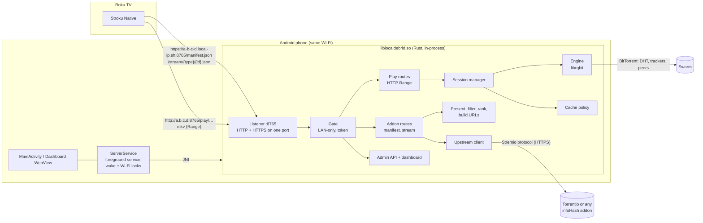

# Architecture

## Overview



The same components in plain text:

```
Stroku ──HTTPS──▶ [Listener] ─▶ [Gate] ─▶ /manifest.json, /stream/…  ─▶ [Upstream addons] ─▶ Torrentio…
   │                                   └▶ /play/<hash>/<sel>/<name> ─▶ [Sessions] ─▶ [librqbit] ─▶ swarm
   └──────────────HTTP (Range)──────────────────────────────────────────────┘
```

## Components

| Module (`crates/localdebrid/src`) | Responsibility |
|---|---|
| `server.rs` | Accept loop. Sniffs the first byte: `0x16` means TLS, anything else is plain HTTP. One port serves both. |
| `http/mod.rs` | Router and the **gate**: refuses non-LAN clients, enforces the access token, and strips the token path segment before routing. |
| `http/addon.rs` | `manifest.json` and `/stream/{type}/{id}.json` |
| `upstream.rs` | Queries every enabled upstream addon in parallel and parses `infoHash`/`fileIdx`/`sources`/title into candidates. Caches results for 10 min and remembers trackers per info-hash for the play request. |
| `release.rs`, `compat.rs` | Release-name parsing (resolution, codec, HDR, audio, source, container) and the device-compatibility verdict |
| `present.rs` | Filtering (compatibility, quality, resolution groups, size), ranking, per-resolution cap, and Stremio stream objects with `url`, `filename`, `videoSize`, `videoHash` and `bingeGroup` |
| `http/play.rs` | `/play/...` (lazy session creation) and `/video/{session}/...`: `HEAD`, `Range`, `206`/`416`, a stall timeout, and a reader guard that notices client disconnects |
| `sessions.rs` | One session per (torrent, file). Per-torrent creation lock, so a player's parallel connections share one session. Idle reaping, the OpenSubtitles hash, persisted file facts. |
| `selection.rs` | Picks the video file: explicit index, file-name hint, season/episode patterns (`S01E02`, `1x02`, season folders, anime numbering) or the largest non-sample video |
| `engine.rs` | librqbit wrapper. Resolves metadata (cached `.torrent` files on disk), adds the torrent restricted to the selected files (`only_files`), opens seekable streams, and removes torrents and data. |
| `cache.rs` | Per-torrent directories, allocated-size accounting (files are sparse), TTL and size eviction of inactive entries, free-space check |
| `tls.rs` | `local-ip.sh` certificate download and renewal (hot-swapped, no restart), or custom PEM files |
| `app.rs` | Startup, shared state, maintenance loop (every 15 s), status, restart supervisor |
| `crates/localdebrid-jni` | `nativeInit/Start/Stop/Status` for the Android app; logcat logging; TLS verifier init |
| `android/` | Kotlin app: `ServerService` (foreground service, `specialUse` type, wake lock, Wi-Fi lock, `START_STICKY`), `MainActivity`, `DashboardActivity` |
| `crates/localdebrid-testkit` | Test-only: HTTP tracker, librqbit seeder and fixture Stremio addon (the e2e script uses it too) |

## Request flow

1. **Listing**: `GET /stream/series/tt0944947:1:2.json` → upstream addons → candidates →
   filters → `{"streams":[{"name":"Local Debrid\n1080p","title":"…👤 120 💾 1.4 GB ⚙️ …",
   "url":"http://192.168.1.25:8765/play/<hash>/s1e2/Show.S01E02.mkv", "behaviorHints":{…}}]}`.
   The title keeps Torrentio's emoji format because Stroku parses seeders and size from it.
   The URL ends with the real extension because Stroku sets Roku's `streamFormat` from it.
2. **Play**: `GET /play/<hash>/<selector>/<name>` with `Range`:
   - selector `3` is a file index, `s1e2` an episode, `auto` the largest video;
   - metadata comes from the running torrent, then `state/torrents/<hash>.torrent`, then
     the swarm (magnet, upstream trackers plus default trackers plus DHT), with a timeout
     (`504` on failure);
   - the torrent is added with only that file selected, into `cache/<hash>/`;
   - the response streams from a librqbit `FileStream` seeked to the range start.
     librqbit prioritises the pieces ahead of each open stream, plus the first and last
     pieces of the file (container headers and indexes).
3. **Seek**: the player closes its connection and opens a new one with another `Range`.
   The dropped stream stops prioritising and the new one takes over.
4. **Pause**: the player stops reading. TCP back-pressure stops the body, nothing times
   out, and the download continues in the background.
5. **End**: after `idleSessionMinutes` with no open connection the session closes. The
   torrent is removed from the engine. Data is deleted immediately
   (`deleteOnSessionEnd`) or later by TTL or size eviction.

## Key decisions

### Engine: librqbit, embedded

| Option | Verdict |
|---|---|
| **librqbit 9** (Rust, Apache-2.0) | **Chosen.** Mature, async, has `FileStream` (AsyncRead + AsyncSeek) with streaming piece prioritisation, `only_files`, magnet resolution, DHT, uTP/TCP, rustls. Builds for Android with `cargo-ndk`, with no OpenSSL. |
| stremio-native/stream-server (Rust, MIT) | Implements the official server API on top of librqbit 8 or libtorrent, with JNI symbols bound to another app's package and a `127.0.0.1` bind. Its value is desktop features (HLS/ffmpeg, archives), and it is large. We would have to fork it and still remove most of it. The useful core is librqbit itself, which we use directly. |
| Stremio's official server.js | Proprietary and not redistributable |
| TorrServer (Go, GPL-3.0) | Mature, but runs as a separate executable on Android. Android 12+ may kill it as a "phantom process", and it would mean managing two processes and two APIs. |
| jlibtorrent (libtorrent via JNI) | Solid engine, but no HTTP/streaming layer. Deadline-based streaming would have to be written by hand. |

The server runs **inside the app process** through JNI. A foreground service plus a
partial wake lock keep it running with the screen off. Child processes (the Termux or
executable approach) are subject to the phantom-process killer and battery restrictions.

### Discovery: reuse existing Stremio addons

The addon does no scraping itself. It consumes **any** addon that returns `infoHash`
streams, through the public protocol (option A), and returns `url` streams to the player
(option B's outcome: the TV never sees BitTorrent). This keeps compatibility with the
whole Stremio ecosystem, adds no proprietary dependency, and lets the user swap sources
(Torrentio is only the default). A magnet can also be opened by hand from the dashboard
or `POST /api/sessions`.

### HTTPS on a LAN

Stroku validates `https://…/manifest.json` against Roku's public CA bundle. The only way
to get a publicly trusted certificate for a LAN IP without a domain is a wildcard DNS
service with a published certificate (`local-ip.sh`). It is pluggable (`tls.mode`:
`localIp`, `custom`, `off`). Video URLs stay plain HTTP on the LAN IP: no DNS
dependency, no TLS cost on the phone.

### Concurrency limits

Every open librqbit `FileStream` holds one permit from librqbit's blocking-I/O semaphore
for its lifetime, and disk writes need a permit too. With too many open streams,
downloads deadlock. The engine is configured with `2 × MAX_CONCURRENT_STREAMS` permits,
and the HTTP layer bounds open streams to `MAX_CONCURRENT_STREAMS` (32). Requests over
the limit wait up to 30 s and then get `503`. A test
(`concurrent_readers_share_one_session`) covers this.

## Storage layout (Android: `noBackupFilesDir`)

```
server/config.json            settings
server/tls/local-ip.{pem,key} cached certificate
server/state/torrents/*.torrent  metadata cache (instant restart of known torrents)
server/state/files/*.json     known file sizes and OpenSubtitles hashes
server/state/dht.json         DHT routing table
torrents/<infohash>/…         downloaded data (the cache)
```

## Security

- Binds `0.0.0.0` but refuses clients outside private, loopback, link-local and CGNAT
  ranges (`lanOnly`).
- No UPnP and no port forwarding. librqbit's UPnP is disabled.
- Optional access token in the path, as a `Bearer` header or as `?token=`.
- Permissive CORS only on addon/play routes (the Stremio protocol requires it), not on
  the admin API.
